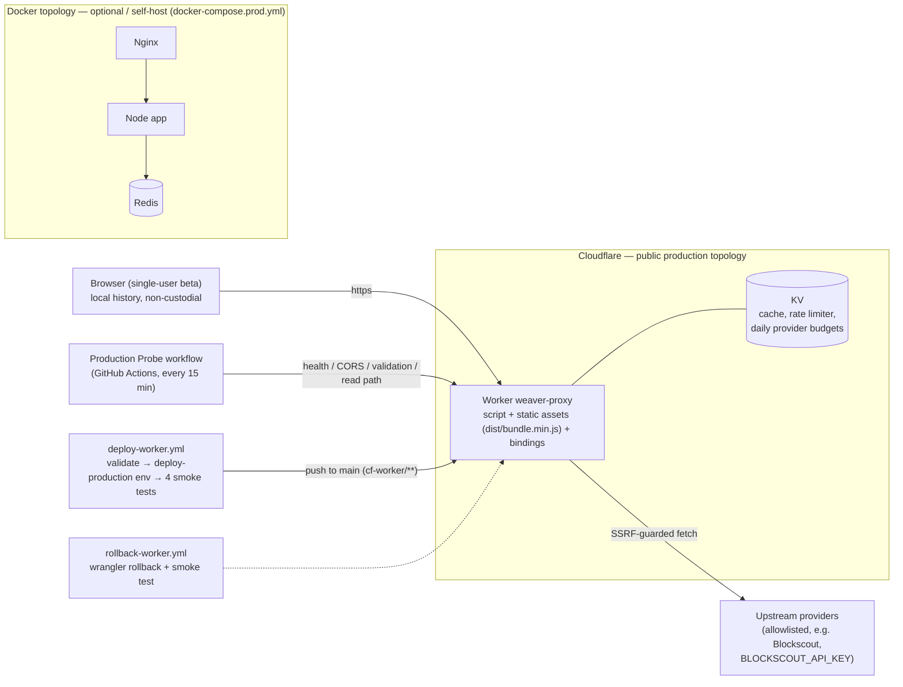

# Weaver Release Matrix and Deployment Topology

Status: recorded 2026-11-24 after the production-readiness recheck
(reviewed commit `04bf500`); updated 2026-11-25 at HEAD `ad3d223`. The
authoritative current-state index is `docs/status-ledger.yml`
(CI-checked by `.github/workflows/docs-status-check.yml`); this document
remains the topology/release control matrix. This document answers the reviewer's
topology questions: which topology serves the public production
service, which component deploys how, where health evidence lives,
and how each piece rolls back. It is part of the release record.

## Architecture

## Topology boundary (the reviewer's questions, answered)

- **Which topology is the public production service?** The Cloudflare
  Worker (`weaver-proxy`). The frontend is served by the same Worker
  as static assets (`/dist/bundle.min.js`), so one deploy carries
  script, assets, and bindings in lockstep.
- **Which services are required for the public UI?** Only the Worker.
  KV is required for cache/limiter/budget accounting; the Worker
  fails open on KV unavailability for some paths (documented risk,
  see Known gaps).
- **Which deployment is authoritative for the proxy routes?** The
  Worker deploy (`deploy-worker.yml`). The Docker/Nginx/Redis
  topology in `docker-compose.prod.yml` is the self-hostable
  alternative recreated from the repository; it is **not**
  authoritative for the public UI.
- **Contract testing across topologies?** The Worker contract is
  pinned by four deploy smoke tests plus the 15-minute external
  probe. The Docker topology's contract parity is currently
  **unproven** (Known gaps).
- **Rollback ownership?** Worker: `rollback-worker.yml`. Docker:
  operator-managed via compose. See matrix below.

## Release matrix

| Component | Deploy workflow / command | Health evidence | Rollback | Data durability |
|---|---|---|---|---|
| Worker script + bindings | `deploy-worker.yml` on push to `main` touching `cf-worker/**`, `wrangler.jsonc`, `_headers`, `.assetsignore`; `validate-worker` dry-runs both configs → `deploy-production` environment → 4 job-failing smoke tests → `RELEASE_MANIFEST.md` artifact (90 days) | Smoke tests (CORS 204, empty-POST 400, discovery-v3, fail-closed 403/503); Production Probe every 15 min | `rollback-worker.yml` — fast path: `wrangler rollback` to a Version ID (recorded in the release manifest); slow path: redeploy the last known-good commit; same environment gate, same smoke test | Stateless; KV durable |
| Frontend bundle (`dist/bundle.min.js`) | Built by `npm run build` (concat.js) + `npm run minify` (esbuild); shipped inside the same Worker deploy | Probe: `/discovery/health` (methodology version); `/dist/bundle.min.js` verified at deploy smoke time and by reviewer checks | Same Worker rollback (assets roll back with the script) | Public build artifact; source of truth in git |
| Docker / Nginx / Redis topology | Operator-managed: `docker-compose.prod.yml` (see `docs/deployment-runbook.md`) | Operator-managed; no automated probe | `docker compose` stop/up; Redis snapshot per compose config | Redis volume per compose |
| Meme data snapshots | `scripts/meme-snapshot-worker.js` (`npm run snapshot:meme` / `snapshot:meme:watch`) | Backup-watchdog alerts are P0 in `docs/observability-plan.md` (not yet implemented) | Re-run snapshot job; restore from retained copy | Operator-managed |
| CI gates | `test-and-build.yml` (npm audit gates + 737 unit / 30 integration / 16 security tests), `gitleaks.yml`, `codeql.yml`, `dependency-review.yml` (blocking), `probe.yml` | Required checks on `main` (see Recorded control state) | Re-run; revert commit | n/a |

## Gate 4 reliability evidence plan

The 30-day Gate 4 window (cycle completion ≥99%, freshness ≤15 min
for 99% of samples, provider success ≥95%, zero unexplained silent
failures, alert latency ≤60s, bounded cache) has **not** completed;
the 24h soak for the discovery-v3 flip started at T0 2026-11-25T08:00:37Z
(live verified 2026-11-25T00:00:34Z and 08:00:37Z); the Gate 4 30-day
evidence window is in progress. Evidence streams:

1. **Availability + methodology**: Production Probe (every 15 min,
   from outside Cloudflare) — durable red/green history with
   structured summaries, 90-day retention.
2. **Deploy history**: `RELEASE_MANIFEST.md` artifacts from every
   production deploy (previous/new Version IDs, smoke results).
3. **Failure record**: Actions history + incident annotations.
4. **Still missing for Gate 4** (P0 observability, per
   `docs/observability-plan.md`): provider outcome summaries,
   alert-delivery timestamps, backup results. Worker-side structured
   logging joins the next `cf-worker/**` deploy window (soak-end) —
   during the soak, `cf-worker/**` changes are held.
5. **Probe content gate** (planned; probe-workflow change, NOT a worker
   change): assert snapshot content — `tokens > 0`, `sum(sourceCounts) > 0`,
   `_meta.errors == []` — and complete bundle download (~738 KB), so an
   empty or truncated snapshot can never pass as fresh (the 2026-11-25
   00:00Z/08:00Z cycles produced zero-token snapshots that a
   freshness-only probe would have passed).

## Recorded control state (2026-11-24)

Branch protection on `main` (verified via API):

- Required status checks: `test-and-build`, `gitleaks`;
  `dependency-review` promoted to required after this PR proved it
  green **without** `continue-on-error` (the repo is public, so the
  dependency graph and Dependabot alerts are on by default).
- Strict (up-to-date branch before merge): enabled.
- Force pushes / deletions: disabled.
- **Administrator enforcement: enabled.**
- **Required conversation resolution: enabled.**
- Required approvals: **0 — documented trade-off** for a
  solo-maintained beta: with one human, a 1-approval requirement
  makes self-merge impossible. `CODEOWNERS` now exists
  (`* @ibis01`); before public production, flip
  `required_approving_review_count=1` +
  `require_code_owner_reviews=true` when a second reviewer exists.
- Required signatures: disabled (no GPG/SSH commit signing in this
  repo).

Deployment environment `deploy-production`:

- Referenced by `deploy-worker.yml` and `rollback-worker.yml`; both
  hard-fail without `CLOUDFLARE_API_TOKEN` (fail-closed, no silent
  green skips) and share the `deploy-production` concurrency group.
- **Gap**: GitHub's REST API returned 404 for the
  `reviewers` / `deployment-branch-policy` endpoints on this account
  (attempted 2026-11-24 — likely plan gating). The environment
  therefore does not yet have a required reviewer or a main-only
  branch policy configured. Operator action: Settings → Environments
  → `deploy-production` → add yourself as required reviewer and a
  `main`-only deployment branch policy if the UI exposes it. Until
  then, the effective deploy gates are: token fail-closed, required
  status checks on main, admin-enforced branch protection, the
  concurrency group, and the smoke tests.

Update 2026-11-25 (HEAD `ad3d223`): required checks on `main` include
`gitleaks` and `dependency-review` (blocking; proven green without
`continue-on-error` in #44); `enforce_admins` and required conversation
resolution are enabled; `docs-status-check.yml` now guards ledger
freshness. Environment reviewer configuration remains an operator UI
step (REST endpoints 404 on this account plan).

## Known gaps (honesty section)

1. KV rate-limiter / provider-budget accounting is read-then-write
   and can overshoot under concurrency; some paths fail open when KV
   is unavailable. Acceptable for a read-only single-user beta; use
   an atomic coordination mechanism (e.g. Durable Objects) if
   provider cost or abuse becomes material.
2. Docker-vs-Worker contract parity is not tested; the smoke
   contract covers the Worker only.
3. Local E2E reproducibility: `npm run test:e2e:install` and
   `npm run test:e2e:doctor` were added so the Playwright browser
   binary can be installed/verified locally; the sandbox reviewer
   environment still lacked the binary, so E2E parity with CI remains
   an operator setup step.
4. Product scope is declared as **public single-user beta**
   (browser-local history, non-custodial, origin/device-scoped
   disclosure). Multi-user SaaS requirements (auth, tenant
   authorization, durable cross-device history, retention/deletion)
   are explicitly out of scope until that decision is revisited.
5. Upstream discovery sources can degrade for whole cron cycles:
   2026-11-25T00:00Z and 08:00Z produced zero-token snapshots with
   `_meta.errors` recorded non-silently (not a quota event — budgets
   healthy, goplus 97/500 at 08:00Z). Detection: Production Probe stream
   + soak annotations; worker fetch-path hardening joins the soak-end
   deploy window.
